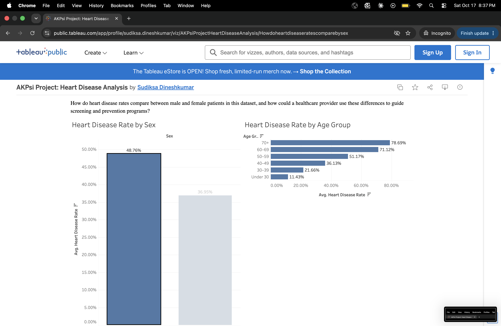

# AKPsi Project: Heart Disease Analysis

## Research Question
How do heart disease rates compare between male and female patients in this dataset, and how could a healthcare provider use these differences to guide screening and prevention programs?

- **Number to measure:** Percentage of patients with heart disease.
- **Group to compare:** Sex.

## Dataset
- **Name:** Synthetic Heart Disease Risk Analysis
- **Source:** [Kaggle dataset](https://www.kaggle.com/datasets/srisyra02/synthetic-heart-disease-risk-analysis)
- **Number of records:** 5,000
- **What one row means:** Each row represents one synthetic patient, including their age, sex, health measurements, and heart disease status.

### Why This Dataset?
This dataset includes both sex and heart disease status, allowing me to compare the percentage of patients with heart disease within each sex group. It also provides an opportunity to practice Python, SQL, and data visualization using a healthcare-related research question.

### Key Columns
- **`sex`:** Patient’s sex. The project feedback identifies `1` as male and `0` as female; this mapping still needs to be checked against the dataset documentation.
- **`num`:** Heart disease status. The analysis treats `0` as no heart disease and values greater than `0` as heart disease.
- **`age`:** Patient’s age, used to compare heart disease rates across age groups in the dashboard.

## Python
Python is used to load and inspect the dataset before the SQL analysis. This step helps identify the dataset’s structure, column names, data types, and missing values.

- **Python and SQL notebook:** [week2_sql.ipynb](https://github.com/sudiksa1307/AKSPI-Project/blob/main/week2_sql.ipynb)

Some columns, including `chol`, `fbs`, and `thal`, contain `?` to represent missing values. These values should be handled before performing numerical calculations on those columns.

## SQL Analysis
The SQL analysis is included in [week2_sql.ipynb](week2_sql.ipynb).

### Q1: How many patients have heart disease?
**Approach:** Count all records and the records where `num > 0`, then calculate the percentage with heart disease.

**Finding:** 2,281 of the 5,000 records (45.62%) show heart disease.

### Q2: How do heart disease rates compare by sex?
**Approach:** Group patients by `sex` and calculate the percentage with heart disease within each group.

**Finding:** Sex group 1 has a heart disease rate of 48.76%, compared with 36.95% for sex group 0. This is an 11.81 percentage-point difference.

Using the sex mapping provided in the project feedback, these results correspond to 48.76% for male patients and 36.95% for female patients. This interpretation remains subject to verification of the sex codes.

### Why Compare Percentages?
The two sex groups contain different numbers of patients. Comparing percentages accounts for these differences in group size and provides a more meaningful comparison than using heart disease counts alone.

## Dashboard

[View my Tableau Public dashboard](https://public.tableau.com/views/AKPsiProjectHeartDiseaseAnalysis/Howdoheartdiseaseratescomparebysex)

**Finding:** In this dataset, heart disease rates were 48.76% for sex 1 and 36.95% for sex 0, a difference of 11.81 percentage points.

### Tableau Visualization
The completed dashboard includes two bar charts:

- **Heart Disease Rate by Sex:** Compares the percentage of patients with heart disease within each sex group.
- **Heart Disease Rate by Age Group:** Compares the percentage of patients with heart disease across age groups.

Clicking a sex bar filters the age-group chart to show results for the selected group. Clearing the selection restores results for all patients.

### How the Rate Is Calculated
A calculated field assigns `1` to records where `num > 0`, `0` to records where `num = 0`, and null to missing `num` values. Tableau averages this field within each group and displays the result as a percentage.

The sex-group percentages match the SQL analysis.

## Main Takeaway
Heart disease rates differ between the two sex groups in this synthetic dataset. These results demonstrate how comparing rates across groups can help identify patterns for further investigation.

In a real healthcare setting, a similar analysis using validated patient data could help providers investigate differences and evaluate screening needs alongside age, medical history, and other risk factors.

Because these records are synthetic, the findings should be treated as a learning exercise rather than evidence for real-world screening or prevention decisions.

## AI Assistance
AI assistance supported the development of the research question, helped explain the SQL analysis, organized the README, and assisted with creating Tableau calculated fields, charts, and dashboard filtering. Query outputs and chart results provide the numerical findings; dataset documentation is still needed to verify the column definitions.

## Limitations
- The dataset contains synthetic patients, so the findings cannot establish real-world heart disease rates.
- The sex-code mapping still needs verification against the dataset documentation.
- The sex comparison does not adjust for age or other health measurements; the age chart provides an additional descriptive view.
- Differences between groups do not establish causation.
- Missing values represented by `?` may require cleaning for future analyses involving other columns.
